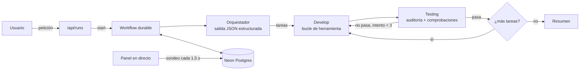

# Equipo de agentes

Tres agentes de IA (**Orquestador**, **Develop** y **Testing**) que trabajan juntos para aplicar cambios a una web. Le pides algo como «añade una página de contacto a esta web» y en pantalla ves, en directo, cómo el Orquestador divide la petición en tareas, cómo Develop edita los archivos y cómo Testing comprueba el resultado y le devuelve lo que falla hasta que todo pasa.

- **App:** _(pendiente de publicar)_
- **Usuario de prueba:** se facilita en la entrega. Ver ejecuciones es público; lanzar una nueva requiere iniciar sesión.

## Qué hace cada agente

| Agente | Qué recibe | Qué hace | Qué entrega |
| --- | --- | --- | --- |
| **Orquestador** | La petición y la web actual | Decide si la petición tiene sentido y la divide en 1–4 tareas pequeñas | Por cada tarea: instrucciones para Develop y un plan de pruebas (2–6 criterios) para Testing |
| **Develop** | Una tarea y, si es un reintento, el informe de Testing | Edita los archivos de la web con la herramienta de edición de texto de Claude (`view`, `create`, `str_replace`, `insert`) | Los archivos cambiados y un resumen de lo que hizo |
| **Testing** | La tarea, su plan de pruebas y la web resultante | Pasa una auditoría automática y escribe comprobaciones propias sobre el DOM real | «Pasa» o «no pasa» con la lista de fallos, el problema y una sugerencia para cada uno |

Si Testing no aprueba, la tarea vuelve a Develop con el informe. Cada tarea tiene hasta **3 intentos**. Al final el Orquestador resume la ejecución.

## Arquitectura



- **Ejecución durable con [Vercel Workflows](https://vercel.com/docs/workflow).** Cada turno de cada agente (una llamada a Claude más las herramientas que pida) es un paso del workflow. Así una ejecución de varios minutos no choca con el límite de 300 s de las funciones del plan gratuito, y un error transitorio de la API se reintenta solo, sin repetir los pasos ya hechos.
- **Todo el estado vive en la base de datos:** ejecuciones, tareas, informes de Testing, estado de cada agente, un registro de eventos, las conversaciones de cada agente y un sistema de archivos virtual con la web de cada ejecución. Cada ejecución parte de una copia limpia de la web de ejemplo.
- **Conversaciones solo de añadir.** El historial de cada agente nunca se reescribe, así que el razonamiento previo y la caché de prompts siguen siendo válidos entre turnos.
- **El panel** consulta el estado cada 1,5 s y recibe solo los eventos nuevos. Muestra:
  - qué hace cada agente en ese momento;
  - el estado de cada tarea y los informes de cada intento;
  - la actividad, con el razonamiento resumido de cada agente;
  - una vista previa de la web;
  - las diferencias en cada archivo.

### Cómo verifica Testing

Testing no aprueba «a ojo». Su veredicto se apoya en dos tipos de comprobaciones:

1. **Auditoría automática (determinista):**
   - HTML válido con [html-validate](https://html-validate.org/), con reglas de accesibilidad: etiquetas en los campos, texto alternativo y nombre accesible en enlaces y botones;
   - `lang`, `title`, viewport y un único `h1`;
   - enlaces, recursos y anclas rotos;
   - páginas a las que no enlaza ninguna otra;
   - errores de sintaxis en JS y llaves descompensadas en CSS.
2. **Comprobaciones del propio agente** sobre el DOM real: que exista un selector, que un texto aparezca, que un atributo valga algo, que una página enlace a otra, etc.

El sistema rechaza un «pasa» si no hay comprobaciones propias, si alguna falla o si la auditoría está en rojo. También rechaza un «no pasa» sin fallos concretos. El informe que recibe Develop lleva cada fallo con su criterio, el problema y una sugerencia.

## Stack

- **Next.js 16** (App Router, Cache Components) en **Vercel**
- **Vercel Workflows** para la orquestación durable
- **Claude Opus 5.5** con el SDK oficial de Anthropic:
  - razonamiento adaptativo con resúmenes visibles;
  - salida JSON estructurada para el plan;
  - herramienta de edición de texto para Develop y herramientas estrictas para Testing;
  - caché de prompts.
- **Neon Postgres** (plan gratuito) con **Drizzle ORM**
- Tailwind CSS v4, Vitest, html-validate y linkedom

El modelo y el esfuerzo de cada agente se configuran por variables de entorno.

### Tiempos y coste medidos

Medidos en local con Claude Opus 5.5 el 23 de noviembre de 2026:

| Petición | Tareas | Intentos | Duración | Coste |
| --- | --- | --- | --- | --- |
| Página de contacto con formulario y horario | 1 | 1 | 1 min 14 s | 0,34 $ |
| La misma, antes de afinar el reparto de tareas | 4 | 5 | 3 min 16 s | 0,92 $ |
| «Escríbeme un poema sobre el mar» (rechazada) | 0 | — | 5 s | 0,03 $ |

La segunda fila sirvió para corregir un fallo real. El Orquestador separaba «crear la página» de «enlazarla desde el menú», así que la primera tarea siempre suspendía la auditoría por dejar una página sin enlazar, y la segunda se quedaba sin nada que hacer. Ahora el Orquestador conoce las reglas de la auditoría y agrupa lo que tiene que ir junto.

## Seguridad y costes

- **Sin claves en el repositorio.** Las claves solo están en `.env.local`, que está fuera de git, y en las variables de entorno de Vercel. `.env.example` documenta qué hace falta.
- **La web generada se muestra aislada.** Se sirve con `Content-Security-Policy: sandbox`, que le da un origen opaco, así que su JS no puede leer cookies ni llamar a la API de la app. Lleva el CSS y el JS incrustados y no puede enviar formularios ni cargar recursos externos.
- **Rutas de archivo validadas:** sin `..`, sin rutas absolutas, solo extensiones de web estática y con límites de tamaño y de número de archivos.
- **Límites de gasto:** una ejecución activa por usuario, 10 ejecuciones al día por usuario y 30 en total (configurable), y peticiones de 600 caracteres como máximo.
- **Sesión** con cookie `httpOnly` firmada (JWT HS256) y contraseñas con scrypt.

## Puesta en marcha en local

Requisitos: Node.js 22 o superior y una base de datos Postgres (por ejemplo, una rama de Neon).

```bash
npm install
cp .env.example .env.local   # y rellena los valores
npm run db:migrate           # crea las tablas
npm run db:seed              # crea el usuario de prueba (SEED_USERNAME / SEED_PASSWORD)
npm run dev
```

Abre <http://localhost:3000>. En local, Workflows usa su «Local World» (guarda el estado en `.workflow-data/`), así que no hace falta nada más.

Comprobaciones:

```bash
npm run typecheck
npm run lint
npm test
npm run build
```

### Variables de entorno

| Variable | Obligatoria | Para qué |
| --- | --- | --- |
| `DATABASE_URL` | Sí | Cadena de conexión de Postgres (Neon) |
| `AUTH_SECRET` | Sí | Firma de la cookie de sesión (32 caracteres o más) |
| `ANTHROPIC_API_KEY` | Sí | Clave de la API de Claude |
| `AGENT_MODEL` | No | Modelo de los tres agentes (por defecto, `claude-opus-5-5`) |
| `AGENT_EFFORT_ORCHESTRATOR` / `_DEVELOP` / `_TESTING` | No | `low`, `medium` o `high` (por defecto, `medium`, `medium` y `low`) |
| `MAX_RUNS_PER_USER_PER_DAY` / `MAX_RUNS_PER_DAY` | No | Límites de gasto (por defecto, 10 y 30) |
| `SEED_USERNAME` / `SEED_PASSWORD` | Solo para `db:seed` | Usuario de prueba |

### Despliegue en Vercel

1. Importa el repositorio en Vercel (se detecta como Next.js).
2. Añade `DATABASE_URL`, `AUTH_SECRET` y `ANTHROPIC_API_KEY` en *Settings → Environment Variables*.
3. Activa la exposición de las variables de entorno del sistema de Vercel (*System Environment Variables*), porque Workflows las necesita.
4. Ejecuta `npm run db:migrate` y `npm run db:seed` contra la base de datos de producción, con `ENV_FILE` apuntando a un archivo con sus variables.

## Cómo se usó Claude Code

Todo el proyecto se programó con **Claude Code** (Claude Opus 5.5), dirigido por mí. Así lo usamos:

- **Análisis y decisiones.** Claude Code leyó el enunciado y comprobó en la documentación de Vercel sus restricciones:
  - el plan gratuito de AI Gateway no incluye modelos de Claude;
  - las funciones de Hobby se cortan a los 300 s;
  - Workflows está incluido en Hobby.

  Con eso propuso la arquitectura: Workflows para la ejecución larga, Neon en lugar de Supabase porque el plan gratuito de Supabase pausa el proyecto tras una semana sin uso, y una web de ejemplo interna en lugar de un repositorio real.
- **Documentación antes que memoria.** Next.js 16 cambia APIs respecto a versiones anteriores. Claude Code consultó la documentación incluida en `node_modules/next/dist/docs/` y la de la API de Claude antes de escribir código.
- **Implementación y pruebas.** Claude Code escribió el código y lo verificó con:
  - TypeScript, ESLint y `next build`;
  - pruebas unitarias del editor de archivos y de las comprobaciones de Testing;
  - el navegador integrado de Claude Code: abrió la app, inició sesión, lanzó ejecuciones y revisó el panel.
- **Errores encontrados al probar.** Ejemplos:
  - el navegador bloqueaba el CSS y el JS de la vista previa aislada, así que ahora se incrustan en la página;
  - eventos duplicados en el panel cuando dos consultas se solapaban;
  - el prefijo técnico de los errores se colaba en los mensajes de la interfaz.
- **Infraestructura.** Claude Code creó la base de datos con el conector de Neon y aplicó las migraciones. Las claves no están en el código: se configuran como variables de entorno.

## Limitaciones conocidas

- Los agentes trabajan sobre una web estática de ejemplo (HTML, CSS y JS), no sobre un repositorio arbitrario. El siguiente paso natural sería conectarlo a un repositorio de GitHub y abrir un PR por ejecución.
- Testing comprueba la estructura y el DOM, pero no ejecuta un navegador real, así que no valida el aspecto visual ni las interacciones complejas de JS.
- El panel se actualiza consultando cada 1,5 s. Con muchos espectadores convendría pasar a *streaming*.

## Estructura

```
app/                  Rutas: portada, login, panel de cada ejecución, API y vista previa aislada
components/           Interfaz (formulario, panel, tarjetas de agentes, tareas, actividad, archivos)
workflows/            El workflow durable y sus pasos
lib/agents/           Los tres agentes, sus prompts y la llamada a Claude
lib/site/             Web de ejemplo, editor de archivos virtual, auditoría y comprobaciones
lib/runs/             Acceso a datos y límites de uso
lib/db/               Esquema de Drizzle
drizzle/              Migraciones SQL
tests/                Pruebas unitarias (Vitest)
```
